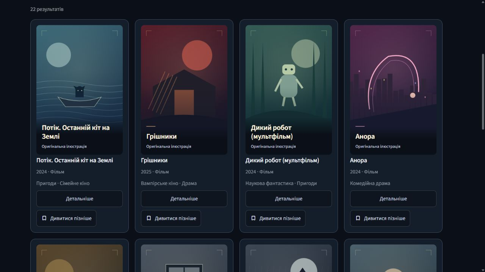
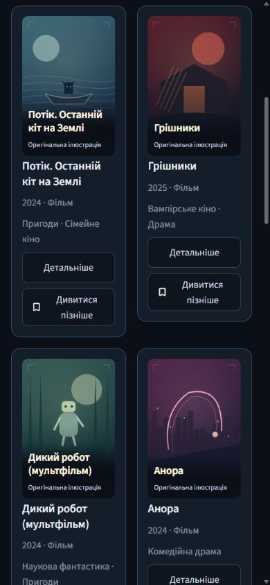

# CineMatch v1.4.2 — Cinematic Artwork Update

Replaces the letter-only fallback for the 22 posterless films in the dated
demonstration catalog with individually composed local SVG illustrations.
Each one is labeled “Оригінальна ілюстрація” / “Original artwork”. These are
not official posters. No TMDB calls, downloaded image assets, third-party fonts,
logos or actor likenesses were used to create them.

The existing eight TVmaze poster URLs are retained and take precedence. Unknown
titles still receive a neutral fallback. The poster switch disables both remote
posters and local illustrations. All catalog data, MovieLens/TVmaze integrations,
ML algorithms, business transitions and schemas are unchanged.

## Validation — 2026-10-17

Local environment: Windows, Python 3.12.14, Streamlit 1.65.0. Browser inspection
used the running `app/portfolio_app.py` with the bundled catalog, synthetic
session profile and no prepared ML pack. It did not use an owner's library or
download training data. The default consumer entry point was covered by AppTest.

Executed targeted suite, **35 passed**:

```text
python -m pytest -q tests/test_cinematic_artwork.py tests/test_product_ui.py
  tests/test_portfolio.py tests/test_library_actions.py
  tests/test_catalog_performance_equivalence.py
```

An isolated local `--basetemp` was used. Initial attempts were stopped by Windows
sandbox/temp-directory setup errors; the completed run passed all 35 tests.
Repository Ruff checks, import ordering for changed Python files, formatting
checks and `git diff --check` also passed. This is targeted validation, not a
claim that the entire research test suite was run locally.

Browser checks:

- Both film pages: 12 + 10 locally embedded SVGs, all loaded.
- Series: all eight images loaded from their existing `static.tvmaze.com` URLs;
  no original-film artwork replaced them.
- Film details: same original illustration and Ukrainian caption as the card.
- English language: translated title and “Original artwork” label.
- Poster switch: all 12 visible illustrations removed, no image elements left;
  restoring the switch restored the artwork.
- Viewports 1280×720, 768×1024, 390×844 and 360×800: no document horizontal
  overflow; no broken images. Mobile 390px uses two compact columns; 360px uses
  one. Details stack on mobile. Temporary viewport override was reset afterward.
- No browser console errors observed.

Real browser captures below contain CineMatch's own SVG compositions and UI.
They are screenshots of the implemented application, not fabricated mockups.





No merge, release publication or deployment is part of this update.
